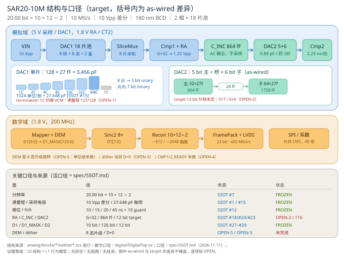

# SAR20-10M —— 20.0 bit / 10 MS/s 两级 SAR（180 nm BCD）

> **架构**：10 bit DT（3 unary + 7 binary）→ **G=32 三级 RA** → **12 bit CT**（C_INC + DAC2 + replica）→ 同笔 8× 重复 → 数字重构。
> **交织**：DAC1 拆 18 片池（8 转换 + 8 采样 + 2 备），量化器 / RA / CT2 / 参考 / 数字全部单套共享。
> **状态**：码域已用 Python 闭合（理想 INL **0.000 LSB20**、SNDR **122.06 dB**、ENOB **19.98**）；**零晶体管仿真、零 RTL 编译、零版图**。



---

## 1. 架构为什么这样选

| 约束 | 结论 |
|:---|:---|
| 20 bit 不能单级（需 2^20 单位） | 必须两级 |
| 10 MS/s 且驱动不能难做 | 2 相部分交织：采样窗占满 100 ns，驱动带宽 **22.3 MHz**（不交织要 89 MHz） |
| 余差要能被二级吃下 | 冗余 2 bit，窗口 ±2 LSB1 = **39.06 mVpp** |
| RA 摆幅 ≤1.7 V | G=32 → 输出 1.25 Vpp（占 73%） |

**位账自洽**：`LSB2 = 39.0625 mV / 2^12 = 9.5367 µV = FS/2^20` —— 二级最低位恰好等于系统最低位，没有「平均折算位」。
`behavioral` 包里有断言锁死这条，改任何位账参数立刻报错。

## 2. 关键数字

| 项 | 值 | 来源 |
|:---|:---|:---|
| 分辨率 / 速率 | **20.0 bit** / 10 MS/s | 位账推导 |
| 输入 / 采样电容 | 差分 10 Vpp；27.6 pF/侧（8×3.456 pF） | 8 片活跃 |
| LSB1 / LSB2 / LSB_total | 9.7656 mV / **9.5367 µV** / 9.5367 µV | 自洽 |
| 帧 / 相位 | 100 ns；**10 / 15 / 20 / 45 ns** + guard 10 | 5 ns 整 tick |
| RA | G=32；A0 ≥50 dB；τ ≤2.04 ns | 前仿待做 |
| 参考 buffer | **Zout ≤0.67 Ω**；平均 2.76 mA | droop 恒等式 |
| 面积 | core 0.93 / die 1.41 mm² | 面积模型（MIM 密度待 PDK） |
| 功耗 | 3.73–4.03 mW | 估算 |

## 3. 现状：哪些是真的

| 层 | 状态 | 证据 |
|:---|:---|:---|
| 码域闭合 | ✅ **已验证** | `behavioral` `runs/smoke_ramp`：σu=0 → INL 0.000 LSB20 |
| 理想动态 | ✅ **已验证** | `runs/smoke_tone`：SNDR 122.06 dB / ENOB 19.98 |
| 失配→INL | ✅ **已验证** | 0.02%→4.6 LSB、0.2%→45.3 LSB（线性） |
| 校准 | ✅ **已验证** | INL 45.3 → 0.65 LSB（27×） |
| 8× 重复 | ✅ **已验证（Python）** | **+1.71 dB**（均匀权，`model/` f2）；+1.86 dB（三角权，`behavioral`）；论文 +1.9；差异来自权重与 ρ |
| 网表层次 | ⚠️ 仅静态 | `check_hier.py`：28 文件 / **222 实例** / 端口一致 |
| 模拟电路 | ❌ **零仿真** | PDK 空；DAC1 termination 仍接 VCM、三电平未接、replica 单套 |
| 数字 RTL | ❌ **零编译** | 本机无 iverilog/verilator |
| 版图 | ❌ **零** | 只有面积模型 |

### 效果图（每张带来源脚注）

| 图 | 回答的问题 | 数据来源 | 等级 |
|:---|:---|:---|:---:|
| `docs/figures/f0_architecture.svg` | 结构 + 口径（target vs as-wired） | 网表逐行 + SSOT | L0 |
| `f1_spectrum` | 100 kHz 的 SNDR/DR/SFDR | `model.adc.simulate` + FFT | L1 |
| `f2_averaging` | 8× 重复值多少 dB | `model.adc.simulate`，M 扫描 | L1 |
| `f3_shuffle` | 片级随机选片换到什么 | `model.adc.simulate`，interleave | L1 |
| `f4_inl` | 0.2% 失配的 INL 与校准残差 | `model.static` → `charge_model` | L1 |
| `f5_skew_gain` | 交织 skew/增益失配的代价 | `model.adc.simulate` + `slice_errors` | L1 |

> 规则：图上每个效果数字带 `[模型]` / `[论文]` / `[估算]`；脚注写脚本、N、seed、SSOT 口径、等级、日期。
> 生成：`python3 -m model.figures_ssot`；清单：`docs/figures/manifest.json`。

## 4. 首要阻塞（按严重度）

| # | 问题 | 影响 |
|:--|:---|:---|
| 1 | **ΦC2 在 SS 角差 0.15 ns**（需 2.40，只有 2.25） | SS 下二级永远超时 → Cmp2 收紧到 ≤1.05 ns |
| 2 | **DAC1 仍产不出真 10 bit**：pool 已改 126-bit mask，但 termination 1C 固定 VCM、三电平未接 | 逐码扫描会少 8/1024 码 |
| 3 | **DAC2 12 bit 分段未定** | C_top / α / kickback 全部参数悬空 |
| 4 | **参考 buffer Zout 需 ≤0.67 Ω**（当前网表拓扑错） | droop 19.97 LSB1，SNDR 崩 |

## 5. 最短复现

```bash
cd 20b10m/behavioral
python -m pip install -e .
python -m sar20b.cli doctor                          # 依赖 / 合同 / 工具 / 字体
python -m pytest -q                                  # 不变量测试
python -m sar20b.cli run --config configs/experiments/ideal_tone.yaml --out runs/tone
python -m sar20b.cli run --config configs/experiments/mismatch_ramp.yaml --out runs/ramp
python -m sar20b.cli figures --run runs/ramp
python -m sar20b.cli report  --run runs/ramp
```

一致性检查（跨文档/跨域，含正反例）：

```bash
python3 tools/check_consistency.py
```

## 6. 下一批任务（可直接分配）

| ID | 任务 | 责任 | 验收 |
|:---|:---|:---|:---|
| T-A01 | 参考 buffer：Zout ≤0.67 Ω @1 k–10 MHz，平均 2.76 mA | 模拟 | Zout 曲线 + 69 pC/0.3 ns 阶跃恢复 <1 ns |
| T-A02 | Cmp2：SS ≤1.05 ns（tail 12→18 µA） | 模拟 | TT 0.9 / SS 1.05 |
| T-B01 | DAC2 12 bit 分段选型（6+6 vs 7+5） | 架构→模拟 | C_top ≤1.8 pF |
| T-B03 | DAC1 网表修到 10 bit（pool 接口已改 126 bit；slice 的 termination 1C 仍固定 VCM） | 模拟 | 1024 码逐码扫，LSB 台阶 = 1 单位 |
| T-C01…C06 | 数字六项（相位 / NB_D2 / Sinc2 / ReconWeights / SliceSched / SerLvds） | 数字 | 出帧率 = fs，逐码 bit-exact |

完整任务表见 `TASKS.md`。

## 7. 文档地图

| 文件 | 作用 |
|:---|:---|
| **`spec/SSOT.md`** | **唯一口径**（分辨率/位账/FS/G/电容/时序/接口/未决项）；所有数从这里引 |
| `spec/params.yaml` | SSOT 的机器可读副本（脚本/RTL/网表生成器读它） |
| `tools/check_ssot.py` | 口径闸门：派生量、代码合同、旧值扫描、必需标记；失败即阻断 |
| `spec/LEGACY_INDEX.md` | 历史文件清单：哪些不能作为设计输入 |
| `STATE.md` | 状态总表（架构 / 模拟 / 数字 / 模型 / 安排） |
| `TASKS.md` | 任务与验收追踪（唯一任务入口） |
| `spec/ADR-001_ARCH_DECISION.md` | 架构决策 + 三候选比较（历史依据） |
| `spec/ARCH_REVIEW.md` | 现存架构的五项余量检查 |
| `spec/DROOP_OPTIONS.md` | droop 的唯一要求（Zout ≤0.67 Ω）与三次修正记录 |
| `spec/MODULES.md` | 模块卡（模拟 7 + 数字 6）+ 接口 |
| `spec/REUSE.md` | 参考库复用表（到文件/符号） |
| `interface/PINOUT.md` | 引脚（最少 17 脚 + 完整 48 脚） |
| `behavioral/` | Python 主引擎（可安装包 `sar20b`） |
| `docs/arch_diagram.svg` | 架构图（可编辑源） |
| `spec/TASKS_ARCH_V2_legacy.md` · `spec/README_ARCH_V2_legacy.md` | 旧口径（20.5 bit / 10+11+1.5−2），仅作历史  SSOT-ALLOW |

## 8. 不宣称的事

- 不宣称 SNDR 99.4 dB 可达（droop / settling 未闭合）；
- 不宣称模拟网表可用（DAC1 仅 7 bit、三电平悬空、replica 开断）；
- 不宣称版图完成（无 PDK 器件、无 DRC/LVS）；
- 不宣称架构已冻结（`spec/ADR-001` 是候选，用户已确认「不大改」，但未逐条签字）。
