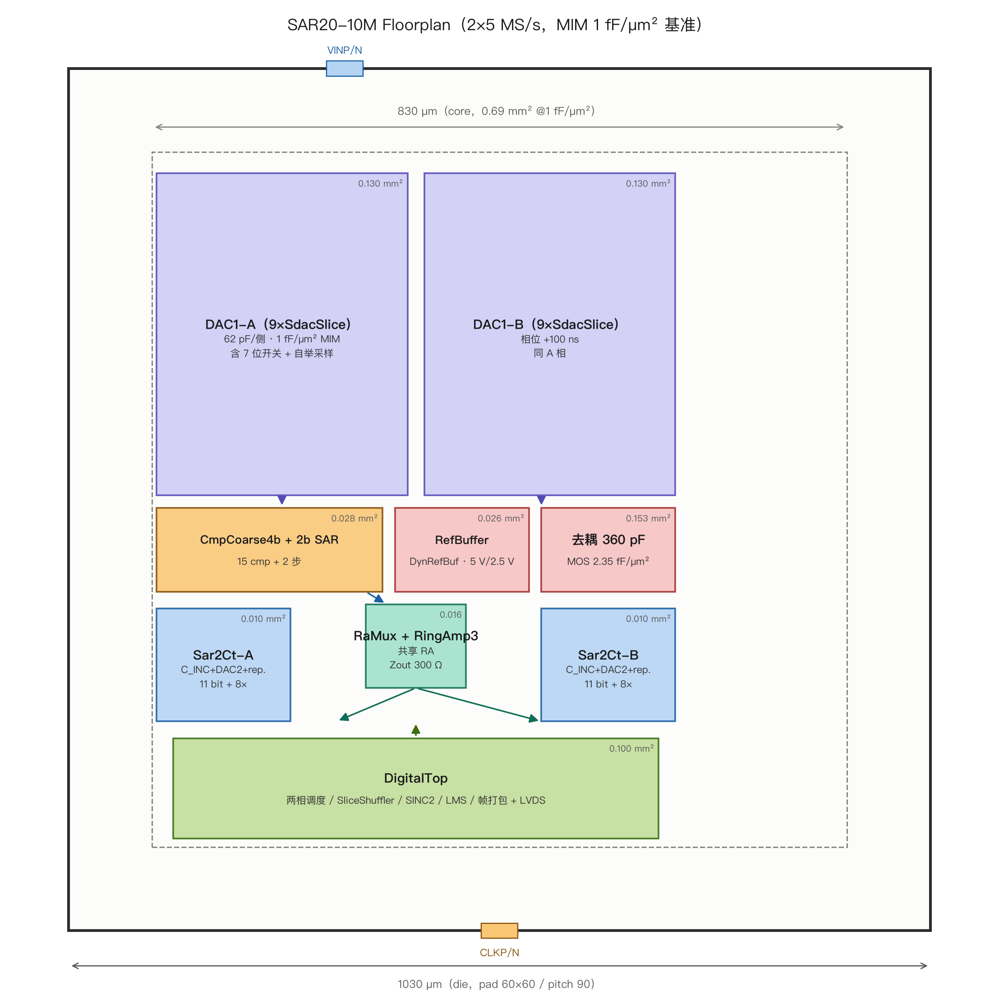

# Floorplan 定义（10 MS/s，die 1030 µm / core 830 µm）

> 图：`floorplan_10m.png`（`make_floorplan.py` 可复现）。
> 面积依据：`area_model.md`，**MIM 1 fF/µm² 基准**。core 0.69 mm²、die 1.06 mm²；若 PDK 能给 2 fF/µm² 堆叠 MIM，core 可回到 0.62、die 0.96。
> 坐标原点在 die 左下角，单位 µm。

## 1. 块坐标与面积（基准档）

| 块 | x0–x1 | y0–y1 | 面积 (mm²) | 备注 |
|:---|:---:|:---:|:---:|:---|
| DAC1-A（9×SdacSlice） | 105–405 | 520–905 | 0.130 | 62 pF/侧，含 7 位开关 + 自举 |
| DAC1-B | 425–725 | 520–905 | 0.130 | 相位 +100 ns |
| `CmpCoarse4b` + 2b SAR | 105–375 | 405–505 | 0.028 | 15 cmp + 2 步 SAR |
| `RefBuffer` / `DynRefBuf` | 390–550 | 405–505 | 0.026 | 5 V + 2.5 V |
| 去耦 360 pF | 565–725 | 405–505 | 0.153 | MOS 2.35 fF/µm² |
| `RaMux` + `RingAmp3` | 355–475 | 290–390 | 0.016 | 共享 RA |
| `Cmp1_A/B` | 285–340 | 335–390 | 0.006 | 紧贴池 |
| `Sar2Ct-A` | 105–265 | 250–385 | 0.010 | C_INC+DAC2+replica |
| `Sar2Ct-B` | 565–725 | 250–385 | 0.010 | 同上 |
| `DigitalTop` | 125–705 | 110–230 | 0.100 | 调度/DSP/帧打包/LVDS |
| 走线/隔离/guard | — | — | ≈0.10 | 其余按 15% 计 |
| **core** | 100–930 | 100–930 | **≈0.69** | 830 × 830 µm |
| **die** | 0–1030 | 0–1030 | **1.06** | pad ring 100 µm/边 |

## 2. 六条硬规则

1. **两池镜像**：A/B 到各自输入 pad 走线等长 **±50 µm**，寄生电容差 ≤2 fF。
2. **RA 在中轴**：两相顶板到 `RaMux` 等长 **±20 µm**，replica 偏斜 ≤50 ps 的物理前提。
3. **参考在中轴上方**：`RefBuffer` → A/B 池 VREF 等长；300 pF 去耦贴 buffer 与池之间，**不跨数字区**。
4. **数字在下边**：末次翻转距采样沿 ≥8 ns；数字电源/地单独 pad，回流不穿模拟区。
5. **时钟在下边中央**：200 MHz 差分进 `ClkRx` 后走对称 H 树；`PHI_S` 驱动器单独供电脚。
6. **粗量化贴输入**：63 个比较器输入电容挂 28 pF 节点，走线总电容 ≤0.6 pF，否则粗量化增益误差 >4%。

## 3. 面积降回 0.53 的四条措施

| # | 措施 | 省 | 代价 |
|:--|:---|:---:|:---|
| 1 | 粗量化移入 110 ns 跟踪窗（6 bit SAR，删 63 cmp） | −0.086 | 数字加 6 拍状态机；ΦC0 只剩预置 |
| 2 | 堆叠 MIM 2 fF/µm² | −0.084 | 需 PDK 选项；电压系数变大 |
| 3 | 去耦 300→150 pF + 有源预充 | −0.064 | droop 23 LSB1，需 R_buf ≤20 Ω |
| 4 | 数字影子寄存器 | −0.017 | 上电 44 µs 灌系数 |
| **全做** | | **−0.251** | **core ≈0.50 / die ≈0.92** |
| **只做 1+3** | | **−0.150** | **core ≈0.60 / die ≈1.00** |

## 4. 封装

| 项 | 基准 | 备注 |
|:---|:---|:---|
| 封装 | **QFN-48 6×6 mm**（原型）/ COB | die 1.06 mm，36 pad，pitch 90–110 µm |
| 键合线 | 金线 25 µm，长度 ≤1.5 mm | 输入/参考线最短 |
|  exposed pad | 接地 | 与 VSSA 低阻连接 |
| 参考去耦 | 片外 100 nF + 10 µF，尽量靠近 VREF5 | 与 AD4080 的封装内 9.4 µF 对照 |
