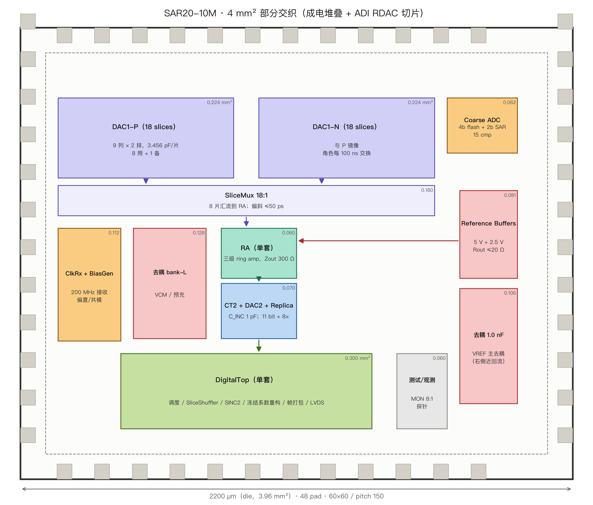

# 4 mm² 部分交织 floorplan（宽松版；对标版见 `area_vs_cicc.md`）

> **注意**：4 mm² 是“什么都放得下”的宽松版。按成电同工艺 die photo（core 0.53 mm² = 813×656，27 fF ≈ 2 fF/µm²）折算，我们的**对标 core 是 0.70–1.0 mm²、die 0.95–1.25 mm²**。首硅建议按对标版，4 mm² 只作备选。

> 图：`floorplan_4mm.png`（`make_floorplan_4mm.py` 可复现）。
> **架构：ADI ISSCC 2024 9.8 式“部分交织”**——只交织 RDAC（DAC1）的 18 片池；**量化器 / RA / CT2 / 参考 / 数字全部单套共享**，转换链每 100 ns 跑一帧 90 ns。
> 面积：die 4.00 mm² / core 3.24 mm²（1800×1800）；48 pad、pitch 150 µm、pad 60×60。



## 1. 部分交织怎么跑（关键）

```
片池：18 片/侧（8 转换 + 8 采样 + 2 备）
A 组：采样 0–100 ──► 转换 100–190 ──► 空闲 190–200
B 组：转换 0–90 ──► 空闲 90–100 ──► 采样 100–200
转换链（量化器/RA/CT2/数字）：0–90、100–190、200–290 … 每 100 ns 一帧
```

- 每片周期 200 ns：**采样 100 ns + 转换 90 ns + 空闲 10 ns**；两组角色每 100 ns 交换。
- **转换链是单套**，只是帧间隔从 200 ns 缩到 100 ns；内部 90 ns 时序完全不变（ΦC0/ΦC1/ΦRA/ΦC2 仍是 7.5/15/25/37.5）。
- 采样在另一组 slice 上并行进行，**输入每 100 ns 被采样一次，但每片仍有 100 ns 跟踪时间**——这就是“部分交织”的全部好处：不牺牲采样窗，也不复制 RA/CT2。

## 2. 分区与坐标

| 区 | 块 | x0–x1 | y0–y1 | 面积 (mm²) | 说明 |
|:---|:---|:---:|:---:|:---:|:---|
| A | **DAC1 pool（18 slices/侧）** | 500–1500 | 1250–1800 | 0.45 | 8 转换 + 8 采样 + 2 备；每片 3.456 pF |
| B | Slice mux / shuffle | 500–1500 | 1120–1230 | 0.110 | 8:1 顶板选通 + DEM 洗牌，偏斜 ≤50 ps |
| C | RingAmp3（单套） | 850–1150 | 900–1080 | 0.054 | 共享 RA，Zout 300 Ω |
| D | 4b flash + 2b SAR | 1230–1470 | 900–1080 | 0.048 | 15 cmp，逐 cmp 修调 |
| E | RefBuffer ×1 | 520–800 | 900–1080 | 0.050 | 5 V + 2.5 V |
| F | Sar2Ct（单套） | 850–1150 | 650–880 | 0.069 | C_INC + DAC2 + replica |
| G | 去耦 1.0 nF | 1520–1850 | 650–1800 | 0.379 | VREF 主去耦 |
| H | 去耦 bank-L | 150–480 | 900–1080 | 0.059 | VCM / 预充 |
| I | DigitalTop（单套） | 300–1200 | 200–550 | 0.315 | 调度/Shuffle/SINC2/LMS/LVDS |
| J | ClkRx + BiasGen | 150–280 | 650–880 | 0.033 | 200 MHz 接收/偏置 |
| K | 测试/观测 | 1230–1470 | 650–880 | 0.058 | MON 8:1 / 探针 |
| — | 走线/隔离/guard | 其余 | | ≈1.4 | 宽走线、guard、深 N 阱 |

## 3. 为什么这样摆

1. **池在顶部、输入 pad 在顶边中央**：18 片分两排（9+9），差分 P/N 对称；输入总线从 pad 直接下到池，长度 <400 µm。
2. **Slice mux 紧贴池底**：8 个转换片的顶板在这里汇到一条总线，再进 RA；mux 到 RA 的走线 <100 µm，偏斜 ≤50 ps。
3. **RA 在中轴、CT2 在 RA 正下方**：单套链路最短；量化器在 RA 右侧，比较器输入直接挂 RA 输入节点。
4. **参考在左、去耦在右**：VREF 从左 buffer 出发，经池底汇流排到 18 片；1.0 nF 在右侧靠近回流的路径上。
5. **数字在底部**：末次翻转距采样沿 ≥8 ns；数字电源/地独立。
6. **两排 slice 的采样开关各自靠近 pad**：避免一条长总线跨全池。

## 4. 关键块：Slice mux / shuffle

这是部分交织唯一新增的模拟难点，比原来 `RaMux` 难一个量级：

| 项 | 要求 | 判据 |
|:---|:---|:---|
| 选通比 | 8:1（每相 8 片并到一条顶板总线） | 8 片同时导通，Ron 失配 ≤5% |
| 换相沿 | <200 ps | 采样沿前完成，不扰动已采样电荷 |
| 偏斜 | ≤50 ps（片到片） | 影响 8 片电荷分配，折算 INL ≤0.1 LSB2 |
| 寄生 | 总线电容 ≤0.5 pF | 相对 28 pF <2% |
| 电荷注入 | <0.1 LSB1 | 换相时注入到顶板 |
| 洗牌 | 每笔随机/轮换 8 片 | 片间失配平均成噪声 |

> 结论：**部分交织的代价不在 RA/CT2，而在这个 8:1 顶板 mux 的偏斜与电荷注入**。它必须和池一起做共质心/等长布局。

## 5. 4 mm² 的面积账（部分交织后更宽裕）

| 项 | 面积 (mm²) |
|:---|:---:|
| DAC1 池（18 片，双侧） | 0.45 |
| Slice mux / shuffle | 0.11 |
| 去耦 1.0 nF | 0.44 |
| 数字 | 0.315 |
| CT2 + RA + 量化器 + 参考 | 0.221 |
| 时钟/偏置/测试 | 0.091 |
| 走线/隔离/guard | ≈1.4 |
| **core** | **3.24** |
| **die** | **4.00** |

> 部分交织把“两套 RA/CT2/参考”省掉了：功耗回到 **≈3.5–3.8 mW**（不是全通道交织的 4.5 mW），面积也空出 0.7 mm² 给去耦和走线。

## 6. 风险

| 风险 | 判据 | 处置 |
|:---|:---|:---|
| 8:1 mux 偏斜 | 片间 >50 ps | 对称树 + 每片串联电阻；版图等长 |
| 换相电荷注入 | INL 台阶 >0.1 LSB2 | 先断后合、dummy 开关、顶板屏蔽 |
| 片间失配 | 洗牌后仍见 fs/2 杂散 | 每片独立增益/失调系数（LMS 扩到 24 片） |
| 参考回流 | VREF 压降 >0.5 mV | 1.0 nF + M6 30 µm + 每片本地 100 pF |
| 两排 slice 不等 | 上下排增益差 | 上下镜像、同向同邻、dummy |
