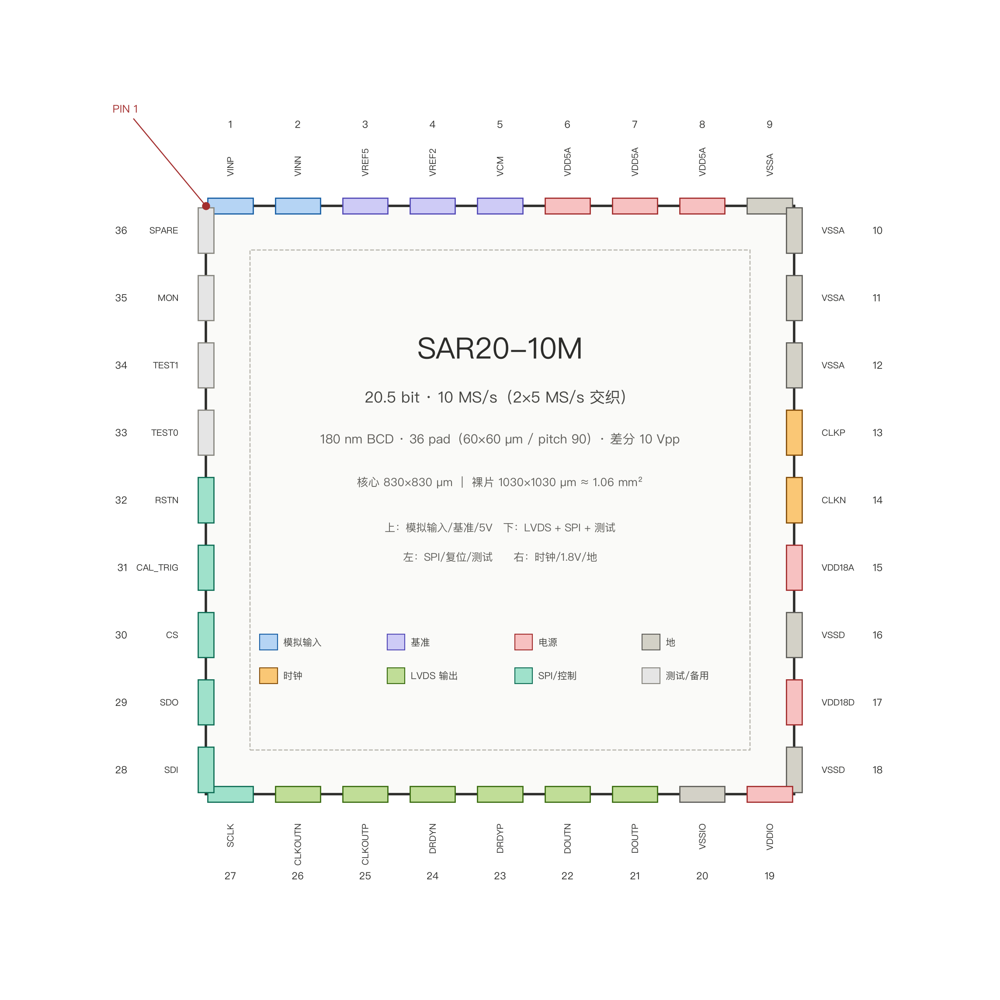

# 芯片引脚定义（36 pad，SAR20-10M）

> 图：`pinout_36pad.png`（同目录）。封装基线：**QFN-48 6×6 mm 或 COB**；pad 60×60 µm、pitch 90 µm；die **2000 × 2000 µm**（4 mm²，core 1800 µm）；36 pad 为最小集，正式版用 48 pad 见 `PINOUT_QFN48.md`。
> 引脚编号从左上角 PIN 1 起，顺时针：上 1–9、右 10–18、下 19–27、左 28–36。输出协议见 `OUTPUT_IF_10M.md`。

## 1. 引脚表

| # | 名称 | 类型 | 域 | 功能 | 备注 |
|:--:|:---|:---|:---|:---|:---|
| 1 | `VINP` | 模拟输入 | 0–5 V | 差分正输入 | 5 V 厚栅 ESD；与 VINN 等长 |
| 2 | `VINN` | 模拟输入 | 0–5 V | 差分负输入 | 同上 |
| 3 | `VREF5` | 基准输入 | 5 V | DAC1 高轨（5.000 V） | 片外 100 nF + 10 µF |
| 4 | `VREF2` | 基准输入 | 2.5 V | DAC2 满量程（2.500 V） | 片外 100 nF |
| 5 | `VCM` | 基准输入 | 2.5 V | 采样共模 / DAC1 复位轨 | 片外 100 nF |
| 6–8 | `VDD5A` ×3 | 电源 | 5 V | DAC1 开关 / 自举 / 参考 buffer 各一路 | 分开供电，各自 ≥1 µF |
| 9–12 | `VSSA` ×4 | 地 | 0 | 模拟地 | 星点回流 |
| 13 | `CLKP` | 时钟输入 | 1.8 V | 200 MHz 差分正端 | 100 Ω 片内端接；专用 pad |
| 14 | `CLKN` | 时钟输入 | 1.8 V | 200 MHz 差分负端 | 与 CLKP 等长 |
| 15 | `VDD18A` | 电源 | 1.8 V | RA / Cmp2 模拟 1.8 V | 单独 LDO |
| 16 | `VSSD` | 地 | 0 | 数字地 | — |
| 17 | `VDD18D` | 电源 | 1.8 V | 数字核心 | 与 VDD18A 分开 |
| 18 | `VSSD` | 地 | 0 | 数字地 | — |
| 19 | `VDDIO` | 电源 | 1.8 V | LVDS / SPI IO | — |
| 20 | `VSSIO` | 地 | 0 | IO 地 | — |
| 21 | `DOUTP` | LVDS 输出 | 1.8 V | 22 bit 串行数据正端 | 400 Mbit/s DDR |
| 22 | `DOUTN` | LVDS 输出 | 1.8 V | 串行数据负端 | 100 Ω 差分 |
| 23 | `DRDYP` | LVDS 输出 | 1.8 V | 数据有效正端 | 与 DOUT 同沿 |
| 24 | `DRDYN` | LVDS 输出 | 1.8 V | 数据有效负端 | — |
| 25 | `CLKOUTP` | LVDS 输出 | 1.8 V | 随路时钟正端（200 MHz） | 源同步 |
| 26 | `CLKOUTN` | LVDS 输出 | 1.8 V | 随路时钟负端 | — |
| 27 | `SCLK` | 数字输入 | 1.8 V | SPI 时钟 | 配置 40 槽系数 |
| 28 | `SDI` | 数字输入 | 1.8 V | SPI 数据入 | — |
| 29 | `SDO` | 数字输出 | 1.8 V | SPI 数据出 | 读观测寄存器 |
| 30 | `CS` | 数字输入 | 1.8 V | SPI 片选 | 低有效 |
| 31 | `CAL_TRIG` | 数字输入 | 1.8 V | 一次性校准触发 | 上升沿 |
| 32 | `RSTN` | 数字输入 | 1.8 V | 复位 | 低有效，内部上拉 |
| 33 | `TEST0` | 数字输入 | 1.8 V | 测试模式 0 | 上电默认 0 |
| 34 | `TEST1` | 数字输入 | 1.8 V | 测试模式 1 | 上电默认 0 |
| 35 | `MON` | 模拟输出 | 1.8 V | 观测缓冲（8:1 mux） | 高阻缓冲，可关 |
| 36 | `SPARE` | — | — | 备用 | 接地或悬空 |

## 2. 电源/地分配

| 域 | 引脚 | 去耦 | 说明 |
|:---|:---|:---|:---|
| 5 V 模拟 | VDD5A ×3 | 1 µF + 100 nF each | DAC1 开关 di/dt 最大，单独一路 |
| 1.8 V 模拟 | VDD18A ×1 | 1 µF + 100 nF | RA / Cmp2 |
| 1.8 V 数字 | VDD18D ×1 | 1 µF + 100 nF | DigitalTop |
| 1.8 V IO | VDDIO ×1 | 100 nF | LVDS 驱动 |
| 地 | VSSA ×4 / VSSD ×2 / VSSIO ×1 | — | 单点星形，数字地不穿模拟区 |

## 3. 关键约束

1. **VINP/VINN 到 pad 的走线电阻 ≤1 Ω、电感 ≤0.5 nH**；两线等长 ±50 µm。
2. **CLKP/CLKN 必须独立 LDO + 专用 pad + ≥5 pF 去耦 + 屏蔽**；抖动验收 1.0 ps、目标 0.5 ps。
3. **DOUT/DRDY/CLKOUT 三对 LVDS 必须真电流型 3.5 mA + 100 Ω**，不许 CMOS 推挽。
4. **MON 缓冲输出串联 1 kΩ**，防止探针电容破坏内部节点。
5. **SPARE 默认接地**；若做 P2 第二对 LVDS，可复用 SPARE + TEST0/1。
6. 所有 5 V pad 用厚栅 ESD；1.8 V pad 用薄栅 ESD；VSSA/VSSD 之间背靠背二极管 + 深 N 阱隔离。

## 4. 与旧接口表的差异

`20b10m/spec/interfaces.csv` 仍是 5 MS/s / 21 bit / CLK 5 MHz 版，**已作废**；以本表 + `spec_tree_10m.md` 为准。
