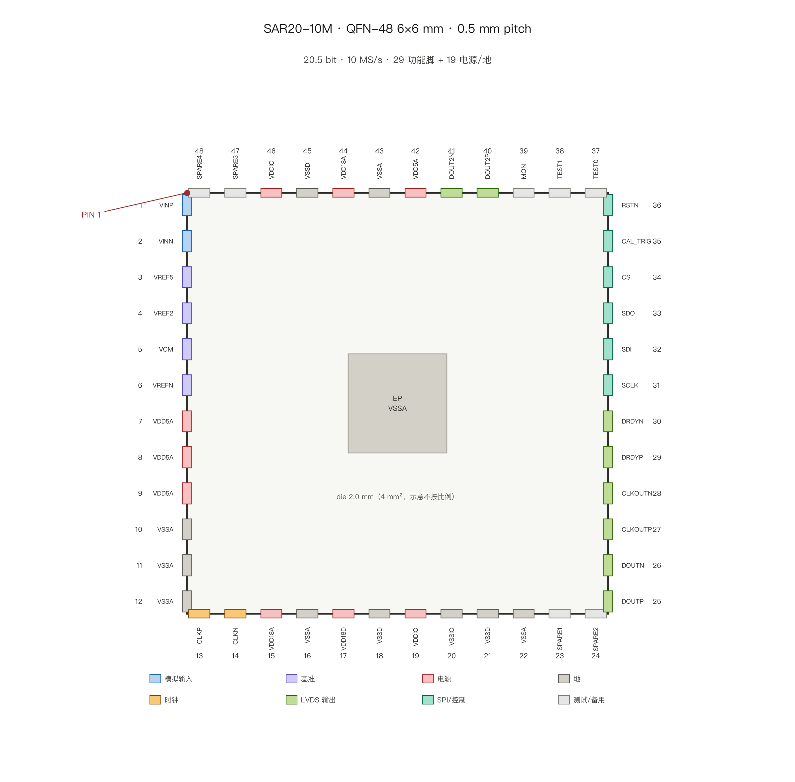

# QFN-48 引脚定义与输入/输出分配（SAR20-10M）

> 图：`pinout_qfn48.png`。封装 **QFN-48，6×6 mm，0.5 mm pitch**；die **2000×2000 µm（4 mm²）**，pad pitch 150 µm，外露焊盘（EP）接 VSSA。
> 编号：俯视，**PIN 1 左上角，逆时针**——左边 1–12 自上而下、底边 13–24 自左而右、右边 25–36 自下而上、顶边 37–48 自右而左。
> **能不能只做 32 脚？** 可以，见 `PINOUT_QFN32.md`；结论是首硅仍建议 36/48 脚，产品版再收 32。

## 1. 48 脚怎么分：29 功能 + 19 电源/地

| 组 | 脚数 | 引脚 | 说明 |
|:---|:---:|:---|:---|
| 模拟输入 | 2 | 1–2 `VINP/VINN` | 差分 10 Vpp，0–5 V/侧 |
| 基准 | 4 | 3–6 `VREF5/VREF2/VCM/VREFN` | 5.0 / 2.5 / 2.5 / 0 V |
| 5 V 电源 | 4 | 7–9、42 `VDD5A` | DAC1 开关/自举/参考 buffer/备用 |
| 1.8 V 模拟 | 2 | 15、44 `VDD18A` | RA / Cmp2 |
| 1.8 V 数字 | 1 | 17 `VDD18D` | DigitalTop |
| IO 电源 | 2 | 19、46 `VDDIO` | LVDS 驱动 |
| 地 | 10 | 10–12、16、22、43 `VSSA`；18、21、45 `VSSD`；20 `VSSIO` | VSSA 6 + VSSD 3 + VSSIO 1 |
| 时钟 | 2 | 13–14 `CLKP/CLKN` | 200 MHz 差分 |
| LVDS 输出 | 8 | 25–30 `DOUT±/CLKOUT±/DRDY±`；40–41 `DOUT2±` | 主 lane + 备用第二 lane |
| SPI/控制 | 6 | 31–36 `SCLK/SDI/SDO/CS/CAL_TRIG/RSTN` | 配置与回读 |
| 测试/观测 | 3 | 37–39 `TEST0/TEST1/MON` | 模式选择、模拟观测 |
| 备用 | 4 | 23–24、47–48 `SPARE1–4` | 可做第二 lane 时钟或地 |

## 2. 逐脚表

| 脚 | 名称 | 类型 | 域 | 功能 |
|:--:|:---|:---|:---|:---|
| 1 | VINP | 模拟入 | 5 V | 差分正输入 |
| 2 | VINN | 模拟入 | 5 V | 差分负输入 |
| 3 | VREF5 | 基准入 | 5 V | DAC1 高轨 |
| 4 | VREF2 | 基准入 | 2.5 V | DAC2 满量程 |
| 5 | VCM | 基准入 | 2.5 V | 共模/复位轨 |
| 6 | VREFN | 基准入 | 0 V | 参考地 |
| 7–9 | VDD5A | 电源 | 5 V | 三路分开 |
| 10–12 | VSSA | 地 | 0 | 模拟地 |
| 13 | CLKP | 时钟入 | 1.8 V | 200 MHz 正 |
| 14 | CLKN | 时钟入 | 1.8 V | 200 MHz 负 |
| 15 | VDD18A | 电源 | 1.8 V | 模拟 1.8 V |
| 16 | VSSA | 地 | 0 | 模拟地 |
| 17 | VDD18D | 电源 | 1.8 V | 数字核心 |
| 18 | VSSD | 地 | 0 | 数字地 |
| 19 | VDDIO | 电源 | 1.8 V | LVDS/SPI IO |
| 20 | VSSIO | 地 | 0 | IO 地 |
| 21 | VSSD | 地 | 0 | 数字地 |
| 22 | VSSA | 地 | 0 | 模拟地 |
| 23–24 | SPARE1/2 | — | — | 备用 |
| 25 | DOUTP | LVDS 出 | 1.8 V | 400 Mbit/s DDR 正 |
| 26 | DOUTN | LVDS 出 | 1.8 V | 负 |
| 27 | CLKOUTP | LVDS 出 | 1.8 V | 200 MHz 随路正 |
| 28 | CLKOUTN | LVDS 出 | 1.8 V | 负 |
| 29 | DRDYP | LVDS 出 | 1.8 V | 帧首正 |
| 30 | DRDYN | LVDS 出 | 1.8 V | 负 |
| 31 | SCLK | 数字入 | 1.8 V | SPI 时钟 |
| 32 | SDI | 数字入 | 1.8 V | SPI 数据入 |
| 33 | SDO | 数字出 | 1.8 V | SPI 数据出 |
| 34 | CS | 数字入 | 1.8 V | SPI 片选 |
| 35 | CAL_TRIG | 数字入 | 1.8 V | 校准触发 |
| 36 | RSTN | 数字入 | 1.8 V | 复位 |
| 37–38 | TEST0/1 | 数字入 | 1.8 V | 测试模式 |
| 39 | MON | 模拟出 | 1.8 V | 8:1 观测缓冲 |
| 40 | DOUT2P | LVDS 出 | 1.8 V | 第二 lane 正（fallback） |
| 41 | DOUT2N | LVDS 出 | 1.8 V | 第二 lane 负 |
| 42 | VDD5A | 电源 | 5 V | 第 4 路 5 V |
| 43 | VSSA | 地 | 0 | 模拟地 |
| 44 | VDD18A | 电源 | 1.8 V | 第 2 路 1.8 V 模拟 |
| 45 | VSSD | 地 | 0 | 数字地 |
| 46 | VDDIO | 电源 | 1.8 V | 第 2 路 IO |
| 47–48 | SPARE3/4 | — | — | 备用 |
| EP | VSSA | 地 | 0 | 外露焊盘，必须多点过孔接地 |

## 3. “输入怎么进、输出怎么出”

**输入（模拟侧）**
- 信号：`VINP/VINN` 差分，0–5 V/侧，10 Vpp；片内 27.6 pF/相采样，两相并行采样。
- 基准：`VREF5`（5 V）、`VREF2`（2.5 V）、`VCM`（2.5 V）、`VREFN`（0 V）全部外供；片内只做 buffer + 300 pF 去耦 + 预充。
- 时钟：`CLKP/CLKN` 200 MHz 差分，片内 ÷20 出 10 MHz 采样沿。

**输出（数字侧）**
- 数据只走 **LVDS 串行**：`DOUT±` 400 Mbit/s DDR，24 bit 帧（22 数据 + VALID + FAULT），帧 60 ns / 周期 100 ns。
- 随路：`CLKOUT±` 200 MHz、`DRDY±` 帧首 10 ns 脉冲；接收端（FPGA）用 IDDR + IDELAY 对齐。
- 配置/回读走 **SPI**（31–34），不占高速脚。
- 若要双 lane fallback：`DOUT2±`（40–41）+ 一根 SPARE 作第二随路时钟，仍不需要并口。

## 4. 为什么不是 22 根并行

22 bit 并行 @10 MS/s = 220 Mbit/s，需要 22 数据 + 1 时钟 + 1 DRDY = **24 个数字脚**；QFN-48 只剩 12 个电源/地脚，**地不够、串扰大、且 6×6 封装边放不下 24 个 0.5 mm pitch 信号脚与必要地**。所以输出统一 LVDS 串行，并行只留在硅测探卡上（探针台不受封装限制）。
