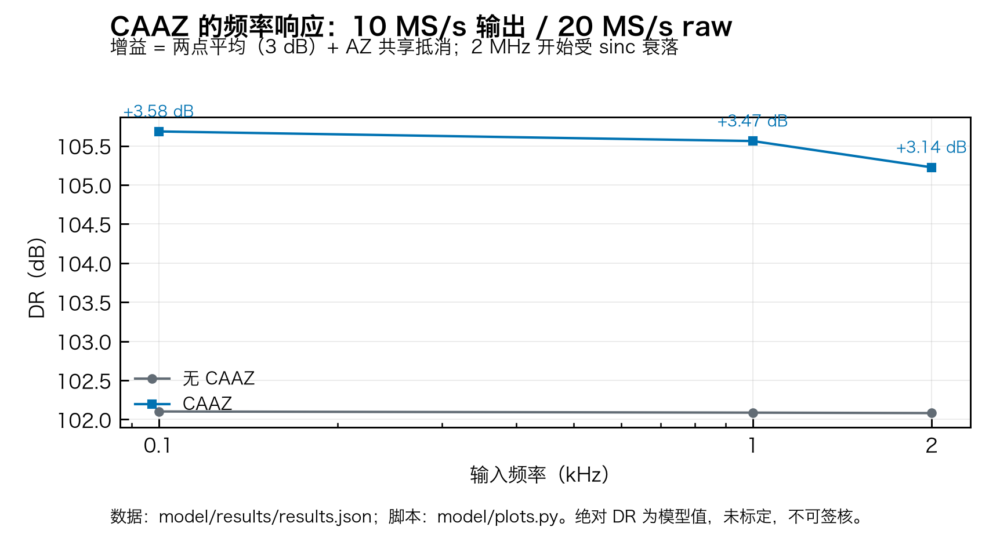
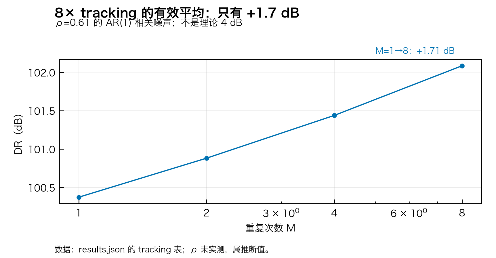
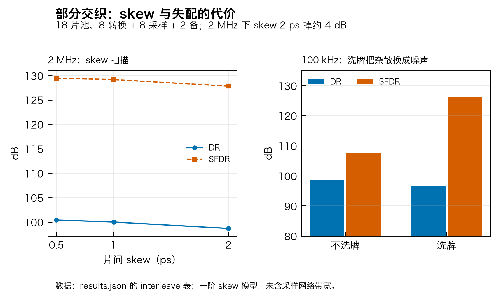
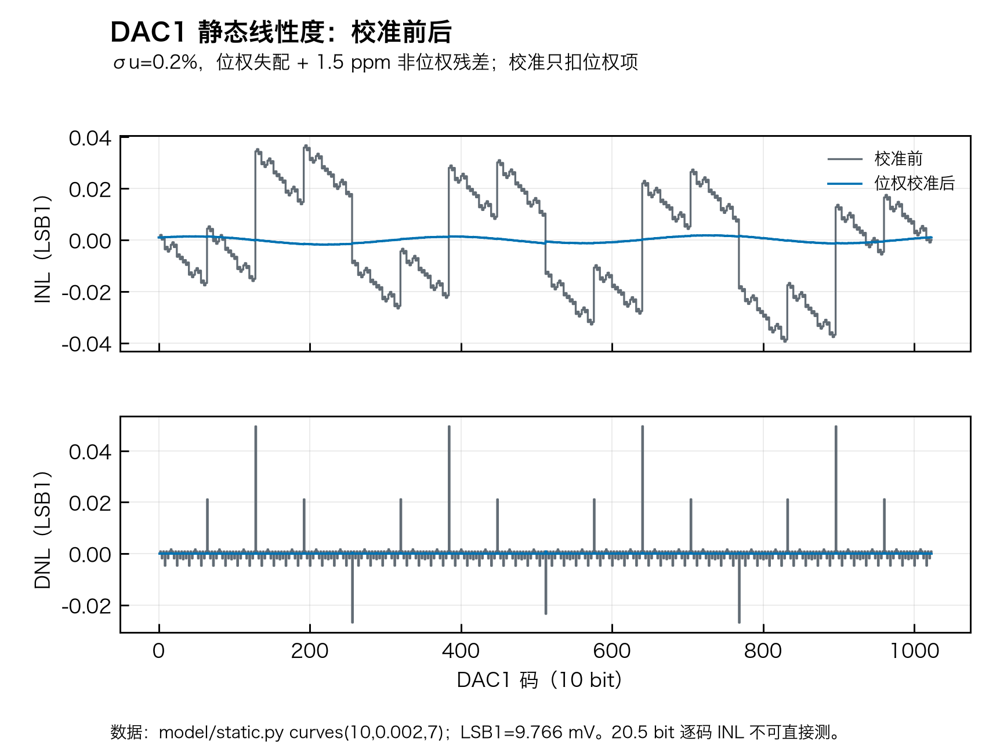
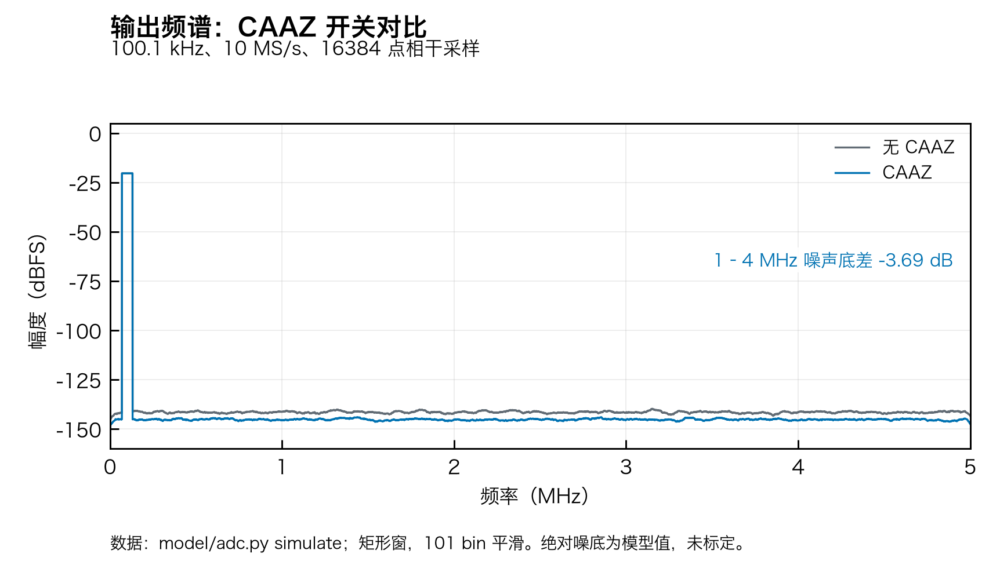

# 模型图件（SAR20-10M）

> 生成：`python3 -m model.plots`（脚本 `model/plots.py`，样式 `model/viz.py`）。
> 清单：`manifest.json`（脚本/数据/输出 SHA256、字体、尺寸、Matplotlib/NumPy 版本）。
> 口径：所有绝对 DR/SNDR 为**模型值，未标定**，不能当签核；图只支持相对结论。



**图 1｜CAAZ 的频率响应。** 10 MS/s 输出 / 20 MS/s raw；100 kHz +3.58 dB，1 MHz +3.47 dB，2 MHz +3.14 dB。其中约 3 dB 是任何两点平均都有的，AZ 共享抵消只贡献约 0.6 dB。数据：[results.json](../results.json) · 脚本：[plots.py](../../plots.py) · 口径：[AUDIT.md](../../AUDIT.md)。



**图 2｜8× tracking 的有效平均。** ρ=0.61 的 AR(1) 相关噪声，M=1→8 只有 +1.71 dB，不是理论 4 dB。ρ 未实测，属推断值。数据：[results.json](../results.json) · 脚本：[plots.py](../../plots.py)。



**图 3｜部分交织的代价。** 左：2 MHz 下 skew 0.5/1/2 ps，DR 从 100.4 掉到 98.7；右：100 kHz 下不洗牌 SFDR 107.5 dBc、洗牌 126.3 dBc，但 DR 从 98.6 掉到 96.5——洗牌把杂散换成噪声。数据：[results.json](../results.json) 的 `interleave` 表。



**图 4｜DAC1 校准前后 INL/DNL。** σu=0.2%、位权失配 + 1.5 ppm 非位权残差；校准只扣位权项，raw 38.6 ppm → cal 1.8 ppm。注意：这是 10 bit DAC1 的逐码曲线，不是 20.5 bit 系统 INL。脚本：[static.py](../../static.py)。



**图 5｜CAAZ 频谱对比。** 100.1 kHz、10 MS/s、16384 点相干采样；101 bin 平滑后 1–4 MHz 噪声底差 3.69 dB。绝对噪底为模型值，未标定。

---

## 复现

```bash
cd 20b10m
python3 -m model.experiments     # 生成 results.json
python3 -m model.plots           # 生成 15 个图件 + manifest.json
```

图件采用 **146 mm 单栏、Hiragino Sans GB（校验“码”）、PNG 300 dpi + SVG(path) + PDF**，与参考仓库 `20b10mtask` 的出图方案一致。设计取舍见 [PLOT_DESIGN.md](../../PLOT_DESIGN.md)。
