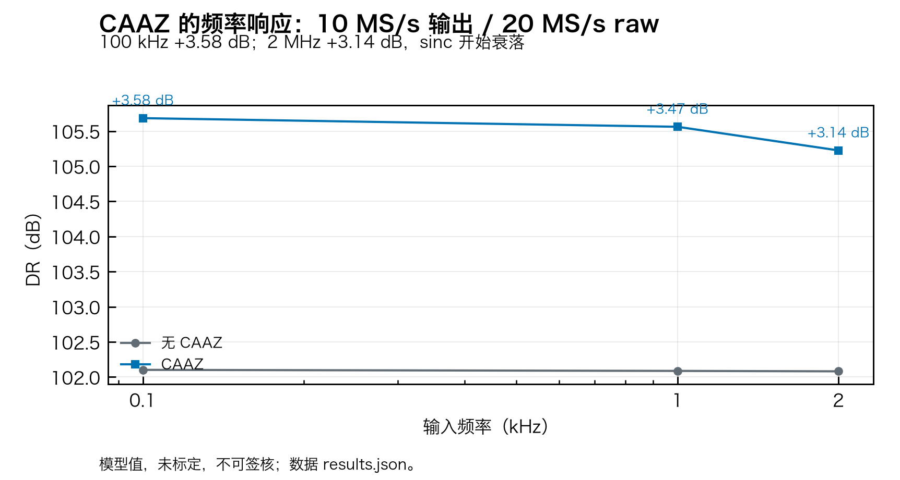
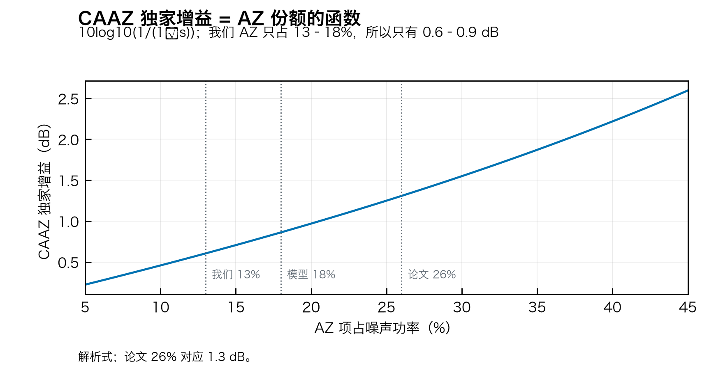
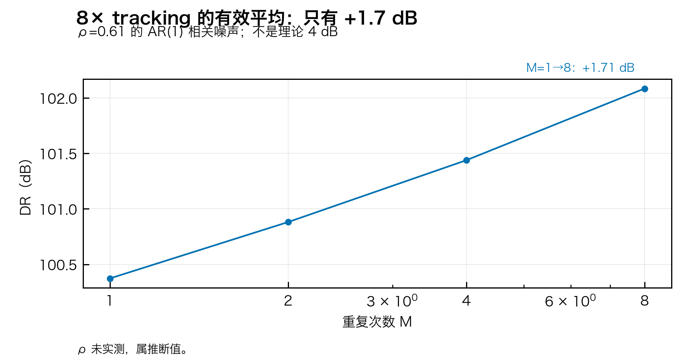
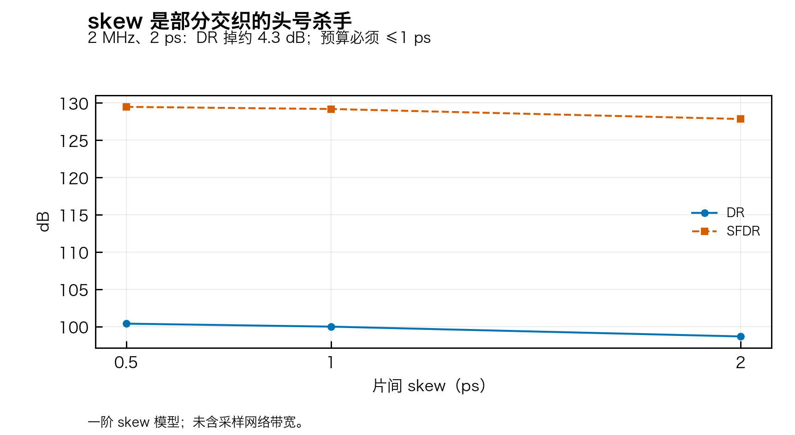
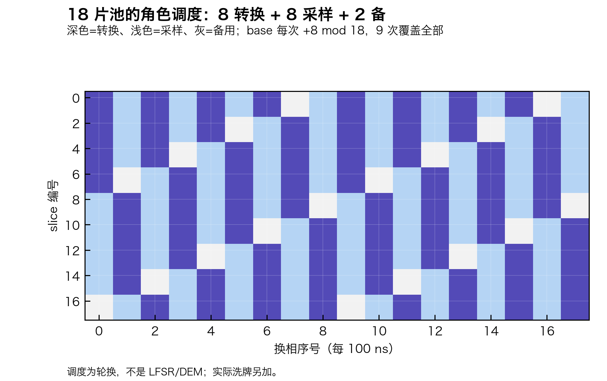
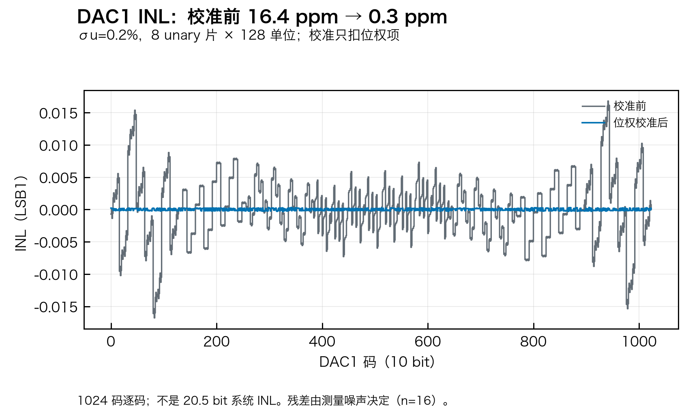
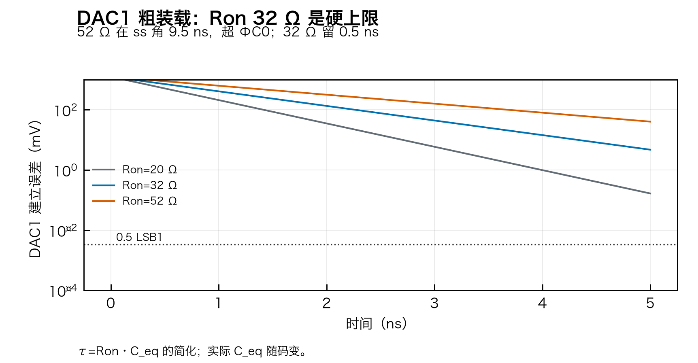
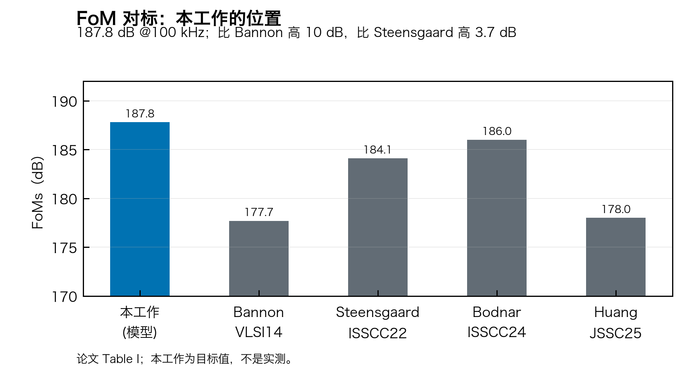

# 诊断图（41 张）

> 生成：`python3 -m model.figures`｜清单：`manifest.json`（脚本/数据/输出 SHA256、字体、尺寸）。
> 绝对指标为模型值，未标定，不可签核；图只支持相对结论。

## A. CAAZ（fig01–07）

**fig01｜CAAZ 频率响应。** 100 kHz +3.58 dB、2 MHz +3.14；其中 3 dB 是两点平均，AZ 抵消只 0.6 dB。

**fig03｜CAAZ 独家增益 vs AZ 份额。** 我们 AZ 只占 13–18%，所以只有 0.6–0.9 dB；论文 26% 才有 1.3 dB。

## B. tracking（fig08–13）

**fig08｜M=1→8 只有 +1.71 dB。** ρ=0.61 的 AR(1)；不是理论 4 dB。

## C. 交织（fig14–22）

**fig15｜2 MHz 下 skew 0.5/1/2 ps。** DR 从 100.4 掉到 98.7；skew 是头号杀手。

**fig21｜18 片角色调度。** 深色=转换、浅色=采样、灰=备用；base 每次 +8 mod 18。

## D. 静态（fig23–29）

**fig23｜DAC1 INL：38.6 ppm → 1.8 ppm。** σu=0.2%；校准只扣位权项。

## E. 噪声/参考/抖动（fig30–35）

**fig34｜DAC1 粗装载建立。** Ron 32 Ω 是硬上限；52 Ω 在 ss 角超 ΦC0。

## F. 系统（fig36–41）

**fig39｜FoM 对标。** 目标 187.8 dB；论文 Table I。

---

完整 41 张见目录；每张都有 PNG/SVG/PDF 三件套。设计取舍见 [PLOT_DESIGN.md](../../PLOT_DESIGN.md)。
