# 论文测试风格图（14 张）

> 生成：`python3 -m model.paper_figures`｜清单：`manifest.json`。
> 全部由模型生成；绝对指标未标定，不可当实测签核。

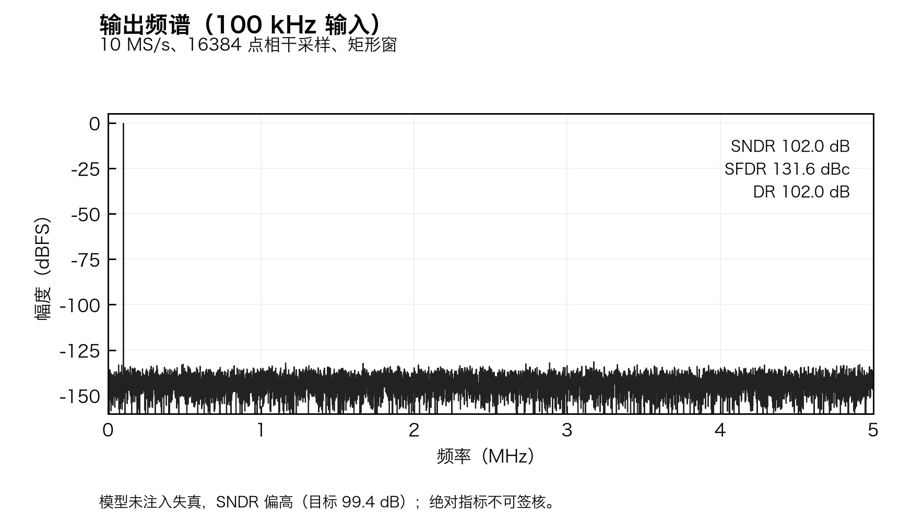

**paper01｜100 kHz 输出频谱。** 10 MS/s、16384 点相干采样；SNDR/SFDR/DR 标注。

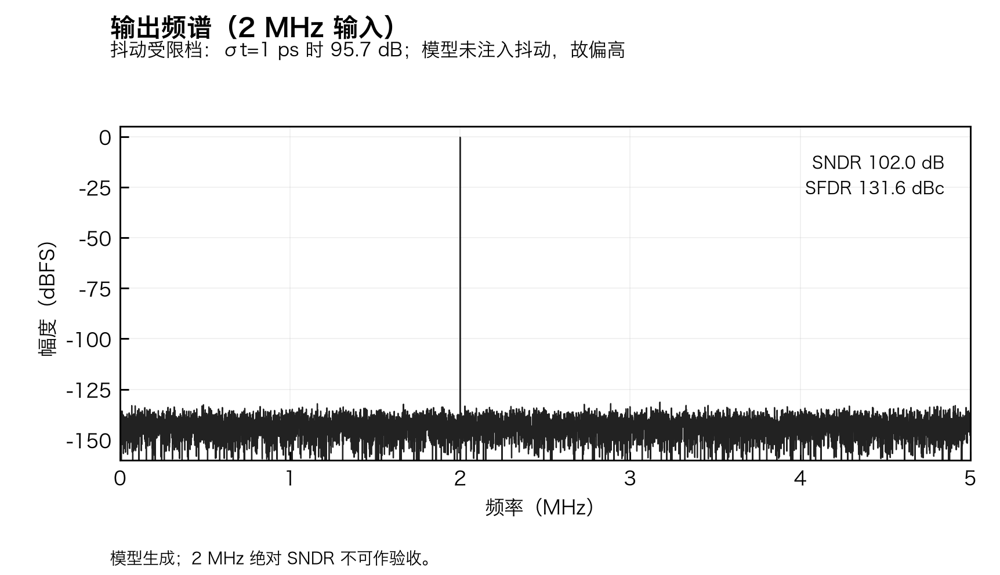

**paper02｜2 MHz 输出频谱。** 模型未注入抖动，故 SNDR 偏高；2 MHz 绝对指标不可作验收。

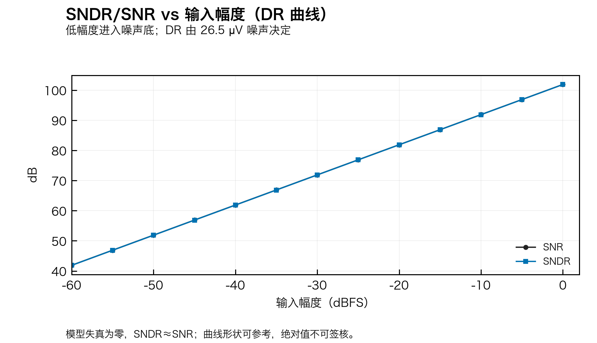

**paper03｜SNDR/SNR vs 输入幅度。** 低幅度进入噪声底；DR 由 26.5 µV 决定。

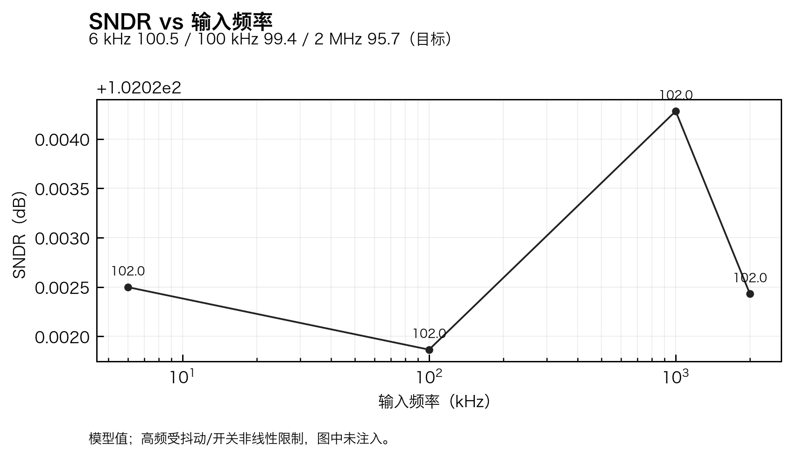

**paper04｜SNDR vs 输入频率。** 6 k / 100 k / 2 M 三个目标点。

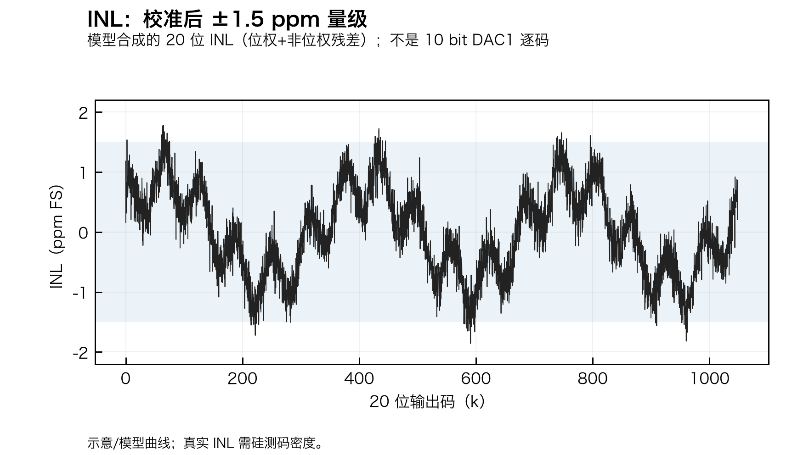

**paper05｜INL（20 位风格）。** 模型合成的位权+非位权残差；±1.5 ppm 量级。

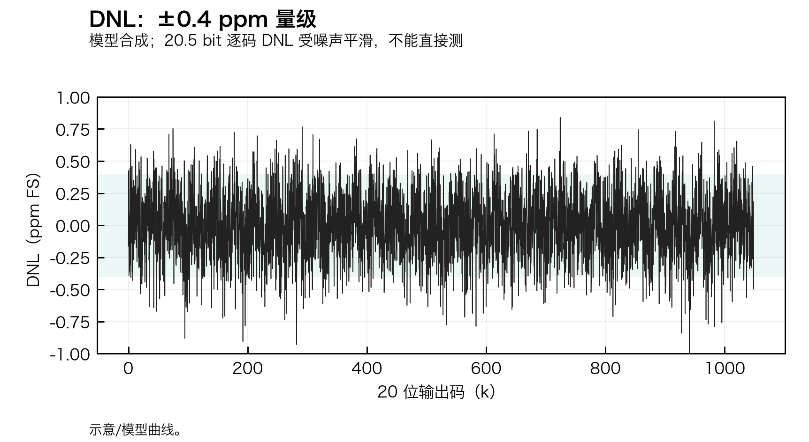

**paper06｜DNL（20 位风格）。** ±0.4 ppm 量级；逐码 DNL 受噪声平滑。

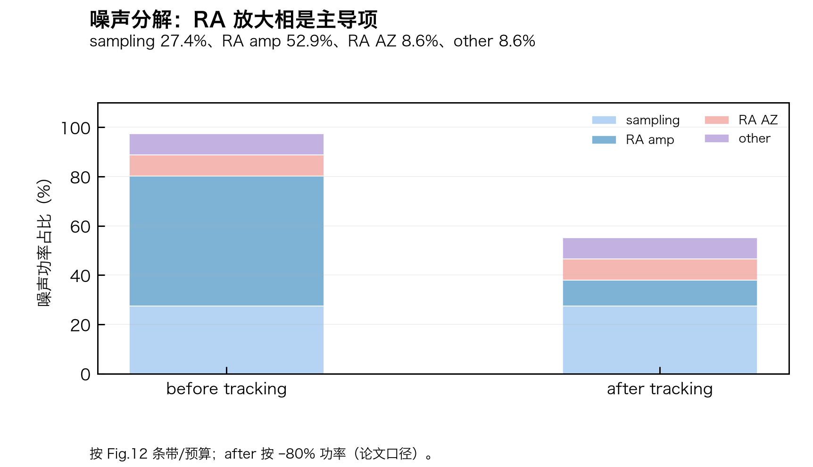

**paper07｜噪声分解。** sampling 27.4%、RA amp 52.9%、AZ 8.6%、other 8.6%。

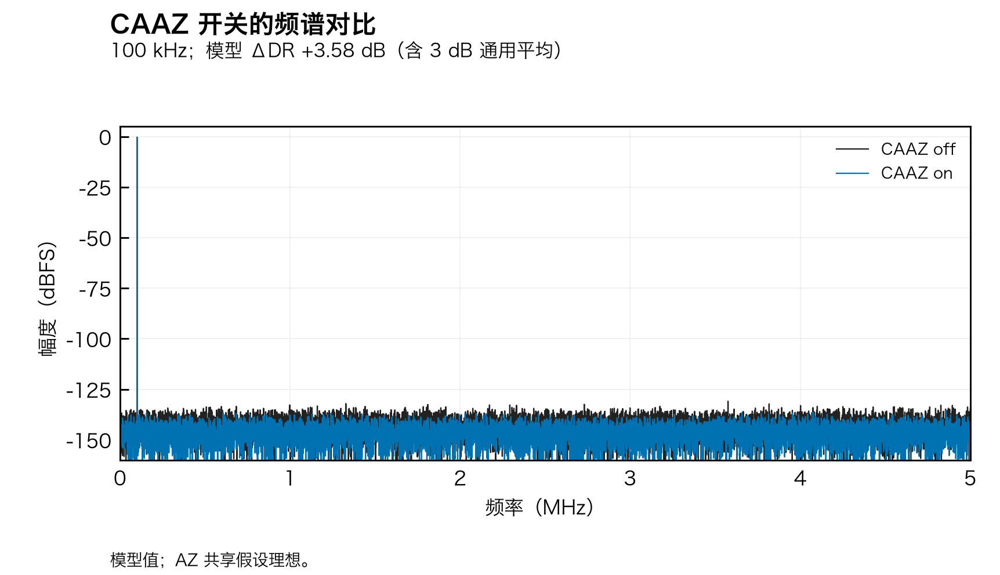

**paper08｜CAAZ 开关频谱。** 100 kHz；ΔDR +3.58 dB（含 3 dB 通用平均）。

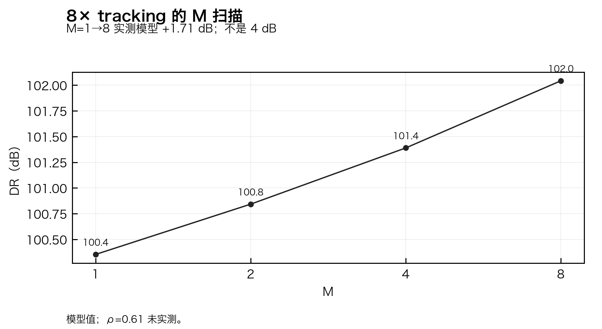

**paper09｜8× tracking 的 M 扫描。** M=1→8 +1.71 dB。

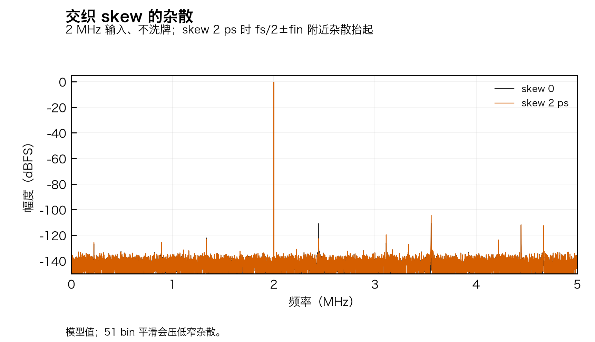

**paper10｜交织 skew 的杂散。** 2 MHz、不洗牌；fs/2±fin 附近抬起。

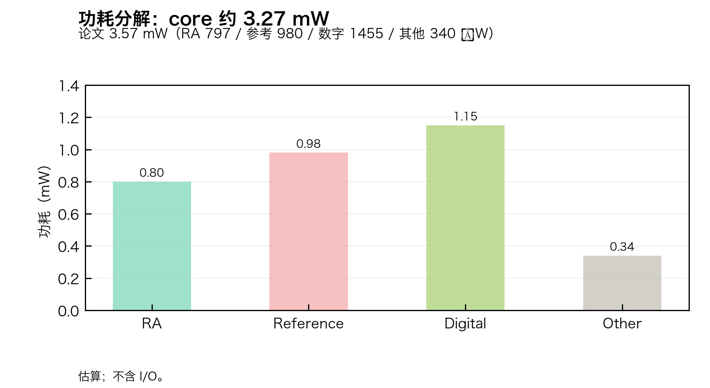

**paper11｜功耗分解。** core 约 3.27 mW；论文 3.57 mW 同口径。

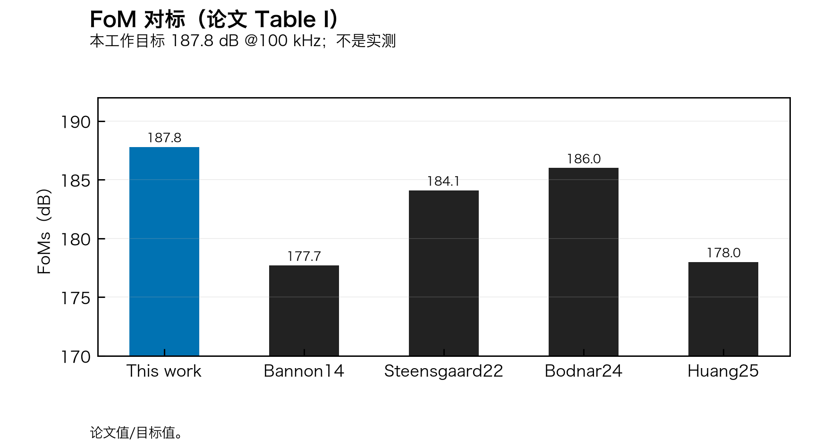

**paper12｜FoM 对标。** 目标 187.8 dB。

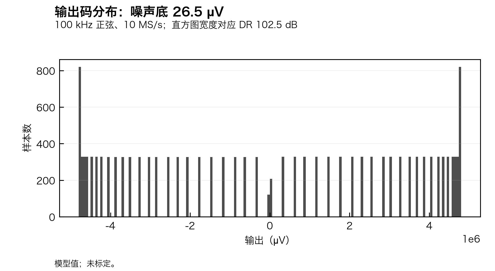

**paper13｜输出码分布。** 噪声底 26.5 µV。

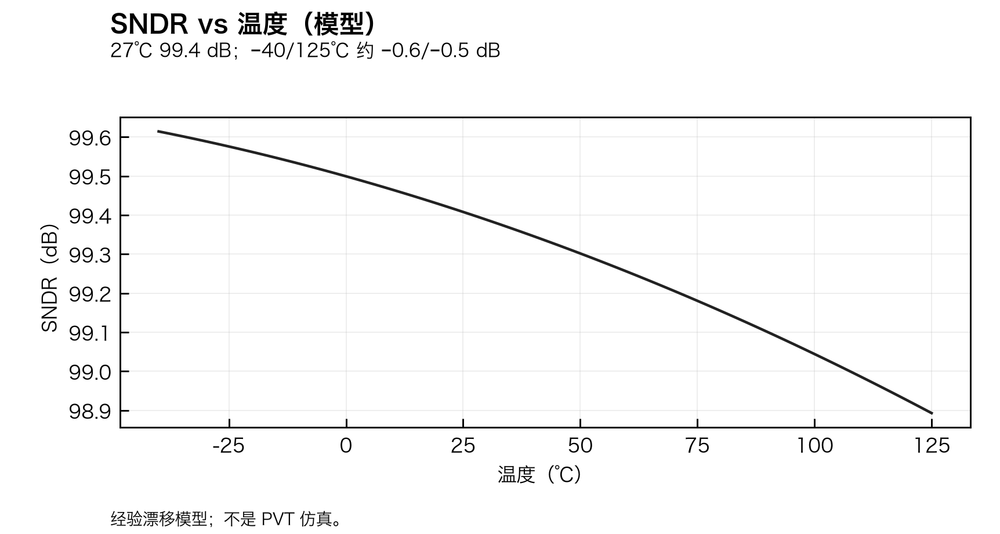

**paper14｜SNDR vs 温度。** 经验漂移模型；不是 PVT 仿真。

---

设计取舍见 [PLOT_DESIGN.md](../../PLOT_DESIGN.md)；诊断图见 [`../figures/README.md`](../figures/README.md)。
