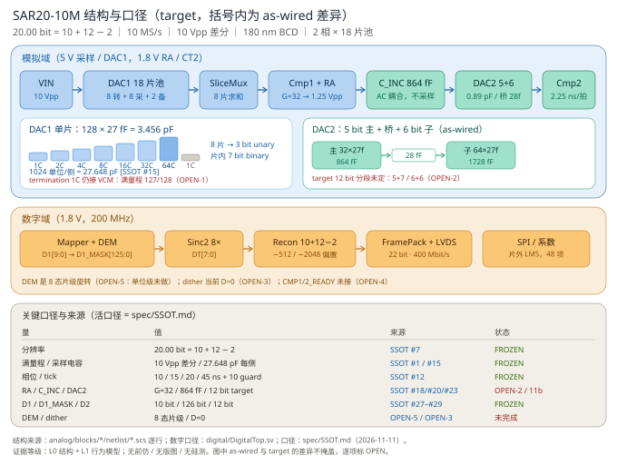

# SAR20-10M —— 20.00 bit / 10 MS/s 两级 SAR（部分交织，180 nm BCD）

> **目标**：复现 CICC 2026（Jin et al., DOI [10.1109/CICC65509.2026.11509489](https://doi.org/10.1109/CICC65509.2026.11509489)）的 CT 二级 + tracking averaging，并用 ADI ISSCC 2024 9.8（Bodnar et al., DOI [10.1109/ISSCC49657.2024.10454329](https://doi.org/10.1109/ISSCC49657.2024.10454329)）式部分交织做到 10 MS/s。
> **状态**：口径已统一（2026-11-11）；行为模型可复现；**模拟零仿真、数字零编译、版图零、硅测零**。
> **唯一口径**：[`20b10m/spec/SSOT.md`](20b10m/spec/SSOT.md)。本页只做入口，不重复数字。



---

## 1. 一句话架构

```
VIN → 18 片 DAC1 池（8 转换 + 8 采样 + 2 备）
    → SliceMux（8 片求和）→ Cmp1 + RA（G=32）
    → C_INC 864 fF（AC 耦合，不采样）→ DAC2（5+6 as-wired / 12 bit target）
    → Cmp2 → DigitalTop（Mapper + DEM + Sinc2 + Recon）→ 22 bit LVDS
```

- 帧 **100 ns**：ΦC0 10 / ΦC1 15 / ΦRA 20 / ΦC2 45 / guard 10。
- 位账 **20.00 = 10 + 12 − 2**；FS **10 Vpp** 差分；采样电容 **27.648 pF/侧**。
- 一级 **10 bit**（4 flash + 2 SAR + 4 fine；电容 3 unary + 7 binary）。
- 二级 **12 bit**（target）；当前网表 **as-wired 11 bit**，分段未定（OPEN-2）。

## 2. 三个 profile（不混算）

| profile | N1 | N2 | 位账 | 用途 |
|:---|:---:|:---:|:---:|:---|
| `target` | 10 | 12 | 20.00 | 规格 / 接口 / RTL / 版图 |
| `as-wired` | 7 | 11 | 18.00 | 当前网表，只用于复现 |
| `candidate_u3b7` | 10 | 11 | 19.00 | 网表修复候选（未授权） |

## 3. 效果图（每张带来源脚注）

| 图 | 回答的问题 | 来源 | 等级 |
|:---|:---|:---|:---:|
| [`f0_architecture`](20b10m/docs/figures/f0_architecture.svg) | 结构与口径（target vs as-wired） | 网表逐行 + SSOT | L0 |
| [`f1_spectrum`](20b10m/docs/figures/f1_spectrum.png) | 100 kHz 的 SNDR/DR/SFDR | `model.adc.simulate` + FFT | L1 |
| [`f2_averaging`](20b10m/docs/figures/f2_averaging.png) | 8× 重复值多少 dB | `model.adc.simulate`，M 扫描 | L1 |
| [`f3_shuffle`](20b10m/docs/figures/f3_shuffle.png) | 片级随机选片换到什么 | `model.adc.simulate`，interleave | L1 |
| [`f4_inl_dnl`](20b10m/docs/figures/f4_inl_dnl.png) | 0.2% 失配的 INL/DNL 与校准残差 | `charge_model` + 有限样本拟合 | L1 |
| [`f5_skew_gain`](20b10m/docs/figures/f5_skew_gain.png) | 交织 skew / 增益失配的代价 | `model.adc.simulate` + `slice_errors` | L1 |
| [`f6_crossval`](20b10m/docs/figures/f6_crossval.png) | 哪些效果统计显著（森林图） | `model.crossval`，K=10 | L1 |
| [`f7_dem_dither`](20b10m/docs/figures/f7_dem_dither.png) | DEM 与 dither 各自贡献 | `model.tech_effects`，K=10 | L1 |

### 技术有效性（交叉验证后）

| 技术 | 结论（K=10，95% CI） | 判定 |
|:---|:---|:---:|
| 8× LSB 重复 | +1.69 dB [1.66,1.72] @100k；解析预测 1.714 | **VALIDATED** |
| CAAZ | +3.65 dB @100k；其中 AZ 只 +0.60 | **VALIDATED** |
| 片级 shuffle | SFDR +22.3 dBc；**DR 方向不稳（+0.9 / −1.7）** | SFDR VALIDATED / DR **NOT VALIDATED** |
| 静态校准 | INL 17.8±4.4 → **0.54±0.04 ppm**（33×）；DNL 0.0235 → **0.00073 LSB1**（32×），失码 0→0；OOS **1.87** | **CONDITIONAL**（OOS 超 ±1.5） |
| 交织 skew / gain | −1.44 dB / −5.58 dB，10/10 | **VALIDATED（退化）** |
| DEM（片级 8 态，模型） | INL **21.8→6.0 ppm（3.6×）**；DNL 0.0234→0.0083 LSB1（2.8×）；网表/RTL 未实现 | 模型 VALIDATED / 实现 OPEN-5 |
| dither（码域 D=2，模型） | DNL **0.0234→0.0051 LSB1（4.6×）**；INL 21.8→20.2（1.08×）；采样态注入未实现 | 模型 VALIDATED（DNL）/ 实现 OPEN-3 |
| DEM+dither | INL **5.0 ppm（4.4×）**；DNL **0.0017 LSB1（13.8×）** | 互补 |
| 跨实现 INL | model 16.4 vs behavioral 43.3 ppm（2.64×） | **DISCREPANT** |

报告：[`review/20261112_crossval.md`](20b10m/review/20261112_crossval.md)；数据：`model/results/crossval/summary.csv`。

> 图上的 `[模型]` / `[论文]` / `[估算]` 是来源标签；脚注写脚本、N、seeds、SSOT 口径、等级、日期。
> 旧图目录 `model/results/figures_measured/` 的 "measured" 是**图风格**，不是硅测；见 [`PROVENANCE.md`](20b10m/model/results/PROVENANCE.md)。

## 4. 快速复现

```bash
cd 20b10m
python3 -m model.selftest          # 4 项自检
python3 -m model.experiments       # 6 s，输出模型结论
python3 -m model.crossval          # 10 seeds × 2 频率，出 95% CI
python3 -m model.figures_ssot      # 生成 docs/figures（带来源脚注 + 误差棒）

python3 tools/check_ssot.py        # 唯一口径闸门
python3 tools/check_consistency.py # 位账 / 端口 / 引脚 / 引用
python3 analog/netlist/check_hier.py
python3 analog/netlist/check_ports.py
```

数字 RTL（需 iverilog/verilator，本机未装）：

```bash
cd 20b10m/digital && make lint && make sim
```

## 5. 证据边界（不许升级）

| 层 | 状态 | 证据 |
|:---|:---|:---|
| L0 结构 | ✅ | 网表 28 文件 / 222 实例；SSOT 检查 0 错 |
| L1 行为 | ✅ | `model.selftest` 4/4；`behavioral` pytest 11 passed；crossval K=10 已过 |
| L2 前仿 | ❌ | 无 PDK、DAC1 三电平未接、DAC2 无 12 bit 分段 |
| L3 后仿 / L4 PVT / L5 硅测 | ❌ | 无版图、无流片 |

**能声称**：码域闭合、模型层面的技术排序（8× / shuffle / 校准）、结构一致性。
**不能声称**：20 bit 精度已复现、SNDR 99.4 dB 可达、DEM 有效、dither 有效、模拟网表可仿真。

## 6. 未决项（唯一清单见 SSOT §7）

| # | 项 | 影响 |
|:--|:---|:---|
| OPEN-1 | DAC1 三电平 + termination 1C 可切换 | 现在只能到 127/128 |
| OPEN-2 | DAC2 12 bit 分段（5+7 vs 6+6） | 网表仍 11 bit |
| OPEN-3 | dither 注入点与幅度 | 当前 D=0 |
| OPEN-4 | `CMP1/2_READY` 握手 | ΦC2 无法闭环 |
| OPEN-5 | DEM 粒度（片级 8 态 vs 单位级） | 只做片级 |

## 7. 目录

```
20b10m/
├── spec/SSOT.md            唯一口径（先读这个）
├── spec/params.yaml        机器可读副本
├── spec/LEGACY_INDEX.md    历史文件边界
├── interface/              模拟↔数字接口、引脚、输出协议
├── analog/blocks/          24 个块的 spec + netlist
├── digital/                RTL 骨架 + testbench + 静态检查
├── model/                  行为模型（CAAZ / tracking / 交织 / 静态）
├── behavioral/             Python 主引擎（sar20b）
├── docs/figures/           带来源脚注的效果图
└── tools/check_ssot.py     口径闸门
```

## 8. 引用

- CICC 2026: C. Jin et al., "A 3.6mW 5MS/s 100dB-SNDR 2-Step SAR ADC with Continuous-Time Second-Stage and Tracking Averaging," DOI 10.1109/CICC65509.2026.11509489.
- ISSCC 2024: R. Bodnar et al., "A 9.3nV/√Hz 20b 40MS/s 94.2dB DR Signal-Chain Friendly Precision SAR Converter," DOI 10.1109/ISSCC49657.2024.10454329.
- 专利：US10505561B2（dither）、US10511316B2（DEM）、US10516408B2、US10707889B1、US10541702B1、US10826519B1。
