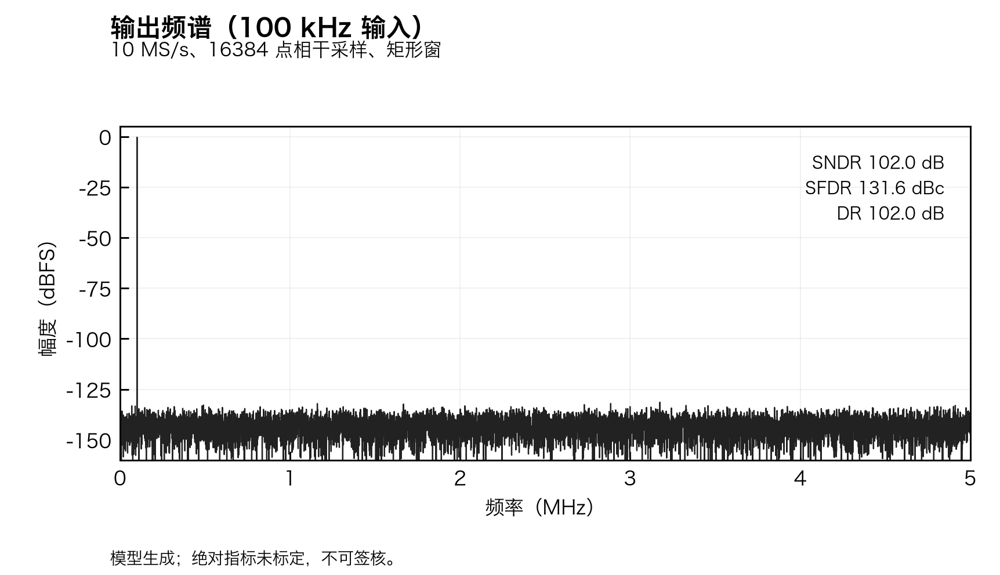
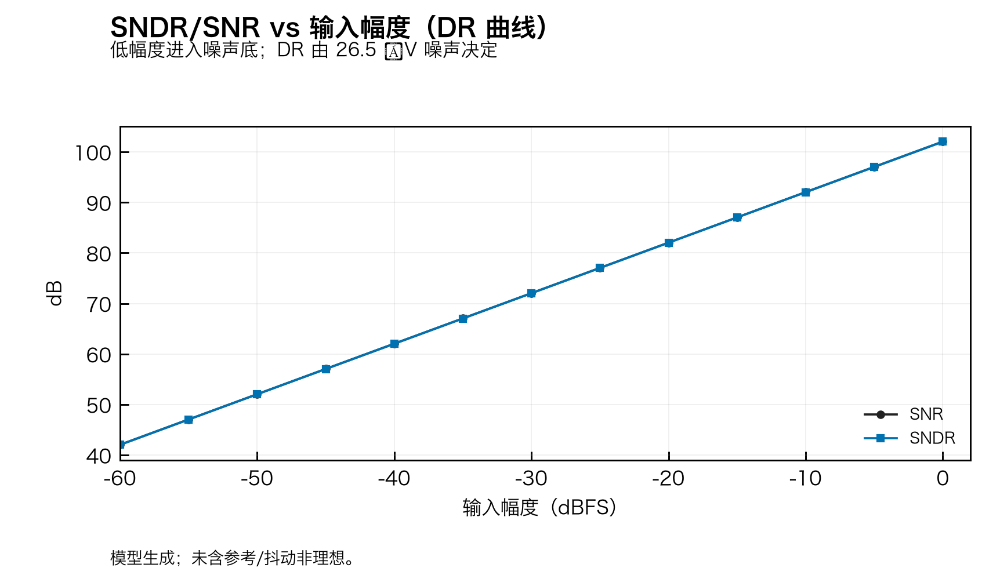
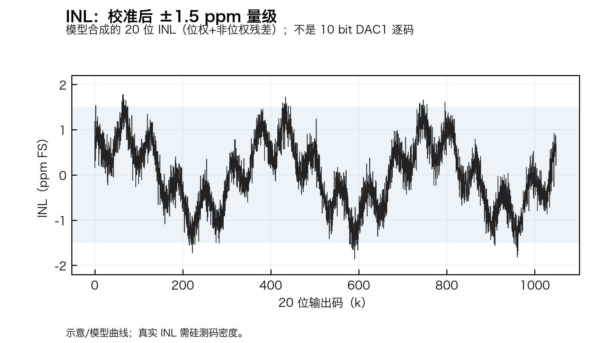
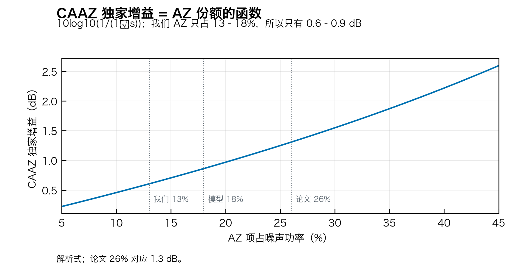
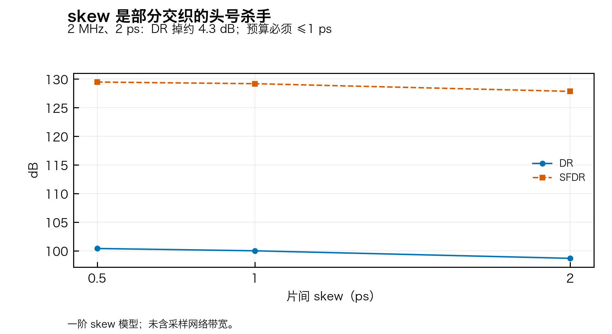
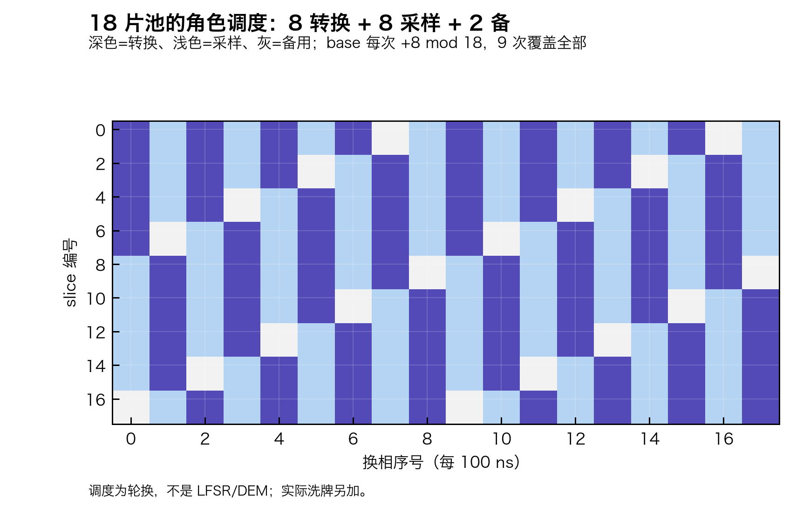

# 20bit10mSarAdc

**20.5 bit / 10 MS/s 两级 SAR ADC 工程**（180 nm BCD）：CICC 2026 成电单相 90 ns 帧 + ADI ISSCC2024 9.8 式**部分交织**——只交织 DAC1 的 18 片池，量化器/RA/CT2/参考/数字单套共享。

> 状态：G0 规格 + 行为模型 + 模拟网表 + 数字 RTL；**无硅测**，绝对指标不可签核。

## 先看

| 内容 | 链接 |
|:---|:---|
| 工程总览 | [20b10m/README.md](20b10m/README.md) |
| 工程组织计划 | [20b10m/PLAN.md](20b10m/PLAN.md) |
| 代码索引 | [20b10m/CODE_INDEX.md](20b10m/CODE_INDEX.md) |
| 模型可信度审计 | [20b10m/model/AUDIT.md](20b10m/model/AUDIT.md) |
| 出图规范 | [20b10m/model/PLOT_DESIGN.md](20b10m/model/PLOT_DESIGN.md) |
| 面积对标成电 | [20b10m/analog/area_vs_cicc.md](20b10m/analog/area_vs_cicc.md) |
| 内部 floorplan | [20b10m/analog/floorplan_4mm.md](20b10m/analog/floorplan_4mm.md) |

## 关键数字

- 20.5 = 10 + 11 + 1.5(8×) − 2；G = 32；FS = 10 Vpp 差分；28 pF/侧/样本。
- 单相帧 90 ns：7.5 / 15 / 25 / 37.5 / 5；转换链每 100 ns 一帧。
- 18 片池：8 转换 + 8 采样 + 2 备；每片 3.456 pF = 128 × 27 fF。
- 输出 22 bit 无符号，LVDS DDR 400 Mbit/s；QFN-48，48 pad。
- 面积：4 mm² 宽松版 / 1.06 mm² 对标版；core 0.69 mm²。
- 功耗：core ≈3.5–3.8 mW；I/O 另计。

## 图（论文测试风格，模型生成）

| 图 | 内容 |
|:---|:---|
|  | 100 kHz 输出频谱 |
|  | SNDR/SNR vs 输入幅度（DR） |
|  | INL（20 bit 风格） |
|  | CAAZ 独家增益 vs AZ 份额 |
|  | 交织 skew 的 DR/SFDR |
|  | 18 片角色调度 |

完整 55 张：`20b10m/model/results/figures/`（41 诊断）+ `figures_paper/`（14 论文风格），各带 `manifest.json`。

## 目录

```
20b10m/
├── plan/        架构裁决、预算、面积、floorplan、SPEC
├── spec/        层次/端口/位分配/时序/10M 规格表
├── interface/   数模接口、QFN-48 引脚、输出协议
├── analog/      25 块 spec + Spectre 网表（build.scs 编译根）
├── digital/     DigitalTop/SliceSched/SAR 控制/SINC2/重构/帧打包/LVDS
├── model/       Python 行为模型 + 结果 + 55 张图
└── docs/        导入步骤与流程模板
```

## 快速运行

```bash
cd 20b10m
python3 -m model.selftest
python3 -m model.experiments
python3 -m model.figures
python3 -m model.paper_figures
python3 analog/netlist/check_hier.py
python3 analog/netlist/check_ports.py
```

## 证据等级

L0 静态 → L1 行为/单元 → L2 前仿 → L3 后仿 → L4 PVT/MC → L5 硅测。**“20.5 bit 精度”“102.5 dB 已复现”只有 L5 才能写。**
